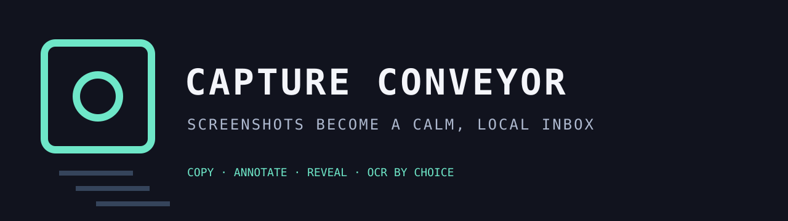
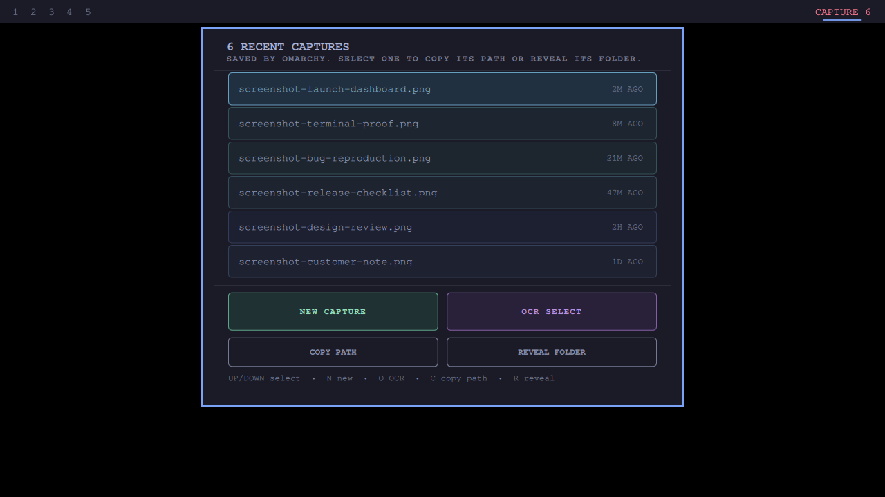

# Capture Conveyor

<!-- intent-select-partner:start -->
<p><a href="https://intentsolutions.io/"></a></p>

Intent Solutions is a Claude Partner Network Select Services Partner.
<!-- intent-select-partner:end -->



[](https://ko-fi.com/U5S225PTME)

Capture Conveyor turns saved Omarchy screenshots into a fast, keyboard-friendly
local inbox. It shows the newest 24 captures, keeps the current selection
obvious, and provides explicit actions for a new capture, path copy, folder
reveal, and a fresh OCR selection.



The preview was rendered on the headless test rig from six fixture files named
the way Omasnap names its captures, placed in `~/Pictures/Screenshots` and found
by the scanner with no folder setting. They are not captures from a live Omasnap
session, which is not installed on the rig.

## Where it looks

Omarchy takes screenshots with Omasnap, which saves to `~/Pictures/Screenshots`.
Capture Conveyor lists the folder Omasnap would save to, in Omasnap's own order
(`src/capture.cpp`, `suggestedScreenshotPathImpl`):

1. `OMASNAP_SCREENSHOT_DIR`
2. `OMARCHY_SCREENSHOT_DIR`, the older name, which `omarchy capture screenshot`
   copies into the first variable when that one is unset
3. `directory` under `[output]` in `~/.config/omasnap/omasnap.conf`
4. `XDG_PICTURES_DIR` from `~/.config/user-dirs.dirs`, plus `/Screenshots`
5. `~/Pictures/Screenshots`

`XDG_CONFIG_HOME` moves the two config files, as it does for Omasnap. The
`XDG_PICTURES_DIR` environment variable is not consulted, because Omasnap and Qt
do not consult it either. Only top-level `screenshot-*.png` files are listed,
which is Omasnap's default naming. A custom `filename` pattern in `omasnap.conf`
that does not start with `screenshot-` is not listed. Stored images are never
OCRed or uploaded automatically.

When the folder cannot be listed the panel says why, with the folder it tried,
instead of showing an empty inbox.

## Limits

- **Scan limit.** The scanner reads at most 2048 directory entries and 256 KiB
  of file names per refresh, counted before anything is sorted. A folder with
  more than 2048 entries is only partly read, and the order a filesystem returns
  entries in is not newest first. The panel then says "Scan limit reached"
  instead of claiming to show the newest captures. Move older screenshots out of
  the folder to bring it back under the limit. Below the limit, the 24 it shows
  are the newest.
- **Symlinks are not followed.** If `~/Pictures`, the folder, or any parent of
  it is a symlink, the scanner refuses it and the panel names the symlink. Set
  `OMASNAP_SCREENSHOT_DIR` to the real folder, which Omasnap honors too. A
  symlinked `user-dirs.dirs` or `omasnap.conf`, for example one a dotfile
  manager links in, is ignored the same way, so set the variable there as well.
- **Config files.** The two config files are read, never written, only when they
  are regular files you own, at most 8 KiB, and are parsed as text and never
  run.

## How it stays safe

All actions use fixed argv arrays. The scanner holds directory and file
descriptors while it reads metadata, opens every path component without
following symlinks, bounds every directory entry and filename byte before
sorting, and never creates a replaceable records file. Ready/attacked race
fixtures prove config and capture directory swaps cannot redirect the inventory.
The QML model validates returned paths again, strips markup, control and
bidirectional text characters from names, and clears stale selections before an
action can receive one.

## Runtime

The scanner is a Perl script that uses only core modules. Perl ships with a
stock Omarchy install, because `git` depends on it. No Node.js, Python or Ruby
is started. Actions call `omarchy`, `wl-copy` and `xdg-open`.

## Why it is different

- Arrow keys move through the recent-capture inbox.
- N starts Omarchy's native screenshot flow; O starts its native OCR selection.
- Enter or C copies the selected path; R reveals the capture folder.
- Failed external actions are visible in the panel instead of disappearing.
- No account, network request, upload, automatic OCR, or image-content read.

## Install

```bash
omarchy plugin add https://github.com/jeremylongshore/omarchy-capture-conveyor-entry --enable
```

Click a row to select it. Middle-click, right-click, or press Enter or C to copy
its path.

## Verify

```bash
npm test
npm run test:race
npm run test:mutation
npm run audit
bash scripts/run-plugin-gates.sh
bash scripts/check-lane-freshness.sh
npm run test:e2e
```

## Maintainers wanted

These plugins are growing, and we are looking for dependable Omarchy users who
want to review issues, test releases, and keep a plugin healthy over time. Start
with a small pull request or [open a maintainer interest
issue](https://github.com/jeremylongshore/omarchy-capture-conveyor-entry/issues/new?template=maintainer_interest.md&title=Maintainer%20interest%3A%20)
titled **Maintainer interest**. Tell us which plugin you use and how you want to
help. Consistent contributors can earn maintainer responsibility.

## License

MIT
